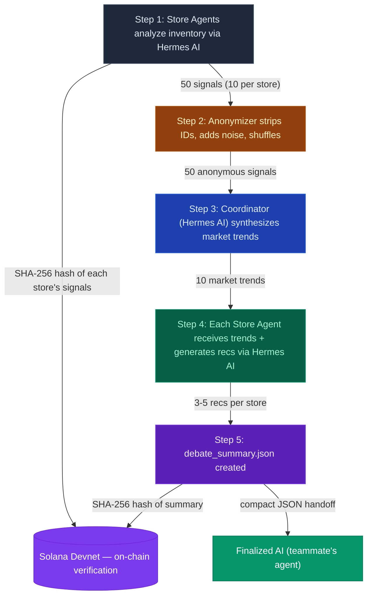

# Tabula — Agentic Marketplace Coordination

> Privacy-preserving multi-agent system that gives small businesses the collective market intelligence that only big enterprises can afford — powered by Hermes AI, verified on Solana.

---

## Pipeline Flow



---

## How It Works

### Phase 1 — Local Analysis
Each store has a personal AI agent (powered by **Hermes 4 70B**) that analyzes its own inventory, sales velocity, owner goals, and constraints. It produces **demand signals** per product category:

```json
{ "category": "craft_kits", "direction": "rising", "intensity": 0.89, "confidence": 0.92 }
```

### Phase 2 — Privacy Layer
Before signals leave the store, the **Anonymizer** strips all identifying information:
- Store IDs removed
- Private reasoning text deleted
- Gaussian noise (sigma=0.05) added to values
- Signal order shuffled randomly

No agent — not even the coordinator — can trace a signal back to its source.

### Phase 3 — Coordinated Intelligence
The **Coordinator Agent** (also Hermes AI) receives 50 anonymous signals and synthesizes them into market-level trends:

```json
{ "category": "craft_kits", "direction": "rising", "strength": 0.685, "consensus": "moderate" }
```

This is the intelligence that big enterprises get from internal data teams. Small businesses get it from each other — without revealing competitive secrets.

### Phase 4 — Personalized Recommendations
Market trends flow back to each store agent. Combined with local context, Hermes generates **personalized procurement recommendations**:

```json
{ "category": "craft_kits", "action": "increase_stock", "confidence": 0.82, "priority": "high" }
```

Each store gets different advice — a craft store is told to stock up, while a gaming store might just promote existing inventory.

### Phase 5 — Solana Verification
Every step is verifiable:

| What | How |
|------|-----|
| Each store's signals | SHA-256 hash committed to Solana via Memo program |
| Final debate summary | SHA-256 hash committed to Solana via Memo program |
| Audit trail | All hashes stored in `verification.json` with timestamps |

If a store claims "I said craft kits were rising" — anyone can check the on-chain hash. No one can rewrite history.

---

## Output Files

| File | Purpose | Consumer |
|------|---------|----------|
| `debate_summary.json` | Compact summary for downstream AI | Finalized AI agent |
| `results.json` | Full pipeline output (trends + recs) | Frontend dashboard |
| `verification.json` | Solana hashes + tx signatures | Audit / trust layer |
| `market_trends.json` | Aggregated trends only | Analytics |
| `group_chat.json` | Agent conversation log | Frontend chat view |
| `conversation_log.json` | Full Hermes API transcript | Debugging |

---

## Tech Stack

| Component | Technology |
|-----------|-----------|
| AI Engine | [Hermes 4 70B](https://nousresearch.com) via Nous Research API (OpenAI-compatible) |
| Verification | [Solana](https://solana.com) Devnet — SPL Memo program for on-chain hash commits |
| Privacy | Differential privacy (Gaussian noise) + identity stripping + shuffling |
| Frontend | React + TypeScript + Vite + Framer Motion + Tailwind |
| Backend | Python 3.14 — agent orchestration pipeline |

---

## Quick Start

```bash
# 1. Set your API keys in .env
NOUS_API_KEY=your_nous_research_key
SOLANA_PRIVATE_KEY=your_funded_devnet_wallet  # optional

# 2. Install dependencies
source .venv/bin/activate
pip install openai python-dotenv solders solana

# 3. Run the pipeline
python main.py --verbose --chat

# 4. Start the frontend
cd demo-ui && npm run dev
```

---

## Why This Matters

Big retailers have data science teams analyzing market trends across hundreds of stores. A single toy shop owner has a gut feeling and a spreadsheet.

**Tabula bridges that gap.** Five small stores sharing anonymized signals — verified on-chain so no one can cheat — get the same quality of market intelligence that Walmart's analytics team produces internally.

No store reveals its sales numbers. No store trusts a middleman. The blockchain proves everyone played fair.
